<h1 align="center">dsh-mattpocock-skills-deck</h1>

<div align="center">

**中文** · [English](docs/README.en.md)

**拨开战争迷雾看见终点，剩下的交给 MattSkillsDeck。**  
让 [mattpocock/skills](https://github.com/mattpocock/skills) 在 DSH 里化作游戏系统的任务面板。

你的 ⭐是我夜空中最亮的星。

*Part the fog of war, see the end — MattSkillsDeck handles the rest.*

[](https://www.npmjs.com/package/dsh-mattpocock-skills-deck) [](https://www.npmjs.com/package/dsh-mattpocock-skills-deck) [](https://www.npmjs.com/package/dsh-mattpocock-skills-deck) [](https://github.com/FeatherHunter/dsh-mattpocock-skills-deck/commits/main) [](https://github.com/FeatherHunter/dsh-mattpocock-skills-deck/graphs/commit-activity) [](https://github.com/mattpocock/skills) [](https://github.com/FeatherHunter/dsh-mattpocock-skills-deck/issues)

<span style="color:red">🔥 欢迎提交PR，不要求完美无瑕，有缺陷也会在合入后进行优化而不是拒绝，星星之火🔥可以燎原！ 🔥</span><br>
唯一要求：使用技能 /pr 填写PR信息。

</div>

<h2 align="center"><sub>INSTALL</sub><br>安装</h2>

<div align="center">

前置要求：[DSH](https://www.npmjs.com/package/@deepseek-ai/dsh)（DeepSeek Harness）。在 DSH 里，你下指令、AI 干活；MattSkillsDeck 把这些活变成面板上的任务。

任务板绑定的仓库需要写权限：新建标签要 push 权限，给票打标签要 triage 及以上权限；只有读权限时能建票、能读票，但补标签、标签流转与 wayfinder 标签都不可用。

</div>

```bash
# ① 安装 DSH CLI（已装跳过）
npm install -g @deepseek-ai/dsh

# ② 安装 MattSkillsDeck —— --profile 必填：装进你实际使用的 DSH 入口对应的 profile
#    （装错 profile 等于没装，重启多少次都不会加载）
dsh plugin --profile web add dsh-mattpocock-skills-deck     # 用自启 web 服务（dsh web）
#     或者
dsh plugin --profile desktop add dsh-mattpocock-skills-deck   # 用 DSH Desktop 桌面应用
# 锁定最新版更稳（当前 1.9.0-beta.9）：
dsh plugin --profile web add dsh-mattpocock-skills-deck@1.9.0-beta.9 --registry https://registry.npmjs.org
#     或者
dsh plugin --profile desktop add dsh-mattpocock-skills-deck@1.9.0-beta.9 --registry https://registry.npmjs.org
```

<div align="center">

装完**重启一次对应的 DSH 入口**即生效：桌面应用完全退出并重开 DSH Desktop；web 服务重启 `dsh web` 后刷新页面。零配置。

**右侧面板性能极致优化：点击到内容可见，真机实测从 5075 毫秒降到 193 毫秒，性能提升约 96.2%（约 26 倍）。**

面板就开在 DSH 自己的右侧边栏里：左边列表、右边详情，并排看。不需要再装别的插件。

**👇 装完重启即生效，初始化六步见下节「初始化流程」，功能逐项见任务板起的各节。**

</div>

<details>
<summary>进阶安装：免全局、更新不生效、交给 AI</summary>

下面命令以 web profile 为例——**DSH Desktop 桌面应用用户请把所有 `--profile web` 换成 `--profile desktop`**。

```bash
# 免全局安装（想更稳，像上面一样锁版本）
npx --yes @deepseek-ai/dsh plugin --profile web add dsh-mattpocock-skills-deck

# 更新被静默忽略时，显式指定官方源
dsh plugin --profile web add dsh-mattpocock-skills-deck@latest --registry https://registry.npmjs.org
```

复制下面这段发给你的 AI，它会确认 profile、检查环境并按需安装：

```text
请帮我安装 DeepSeek Harness 插件 dsh-mattpocock-skills-deck（MattSkillsDeck）。
先读仓库 README：https://github.com/FeatherHunter/dsh-mattpocock-skills-deck
先确认我实际使用的 DSH 入口对应哪个 profile（DSH Desktop 桌面应用 → desktop；自启 web 服务 → web），把插件装进正确的 profile；
然后自行检查环境并按需安装（已装的跳过），完成后简要汇报结果。
```

</details>

升级 · 卸载（desktop profile 用户把 `--profile web` 换成 `--profile desktop`）：

```bash
dsh plugin --profile web update dsh-mattpocock-skills-deck   # 升级
dsh plugin --profile web remove dsh-mattpocock-skills-deck   # 卸载
```

<h2 align="center"><sub>INIT FLOW</sub><br>初始化流程</h2>

<div align="center">

新工作区六步走完即开工：建工作区、开会话、选后端、确认注入、等 AI 执行、过环境检查。下面是深色中文界面的实拍。

<table>
  <tr>
    <td valign="top"><br>第 1 步：创建新工作区</td>
    <td valign="top">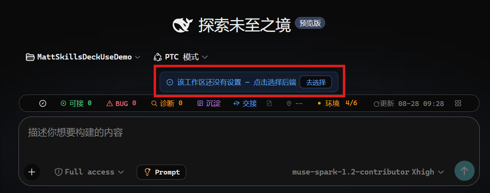<br>第 2 步：新建会话并选择后端</td>
  </tr>
  <tr>
    <td valign="top">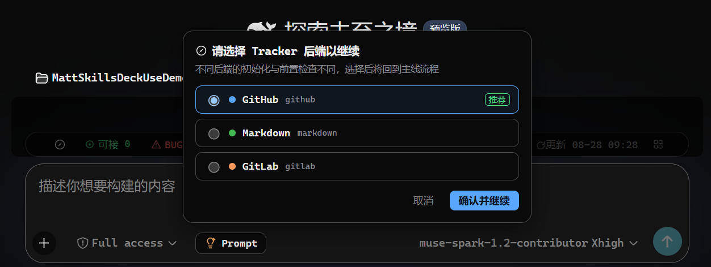<br>第 3 步：选择后端为 GitHub</td>
    <td valign="top">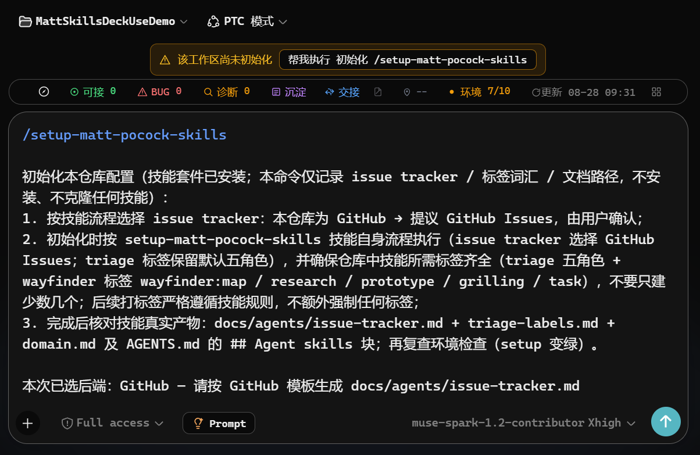<br>第 4 步：点击确认后注入提示词</td>
  </tr>
  <tr>
    <td valign="top">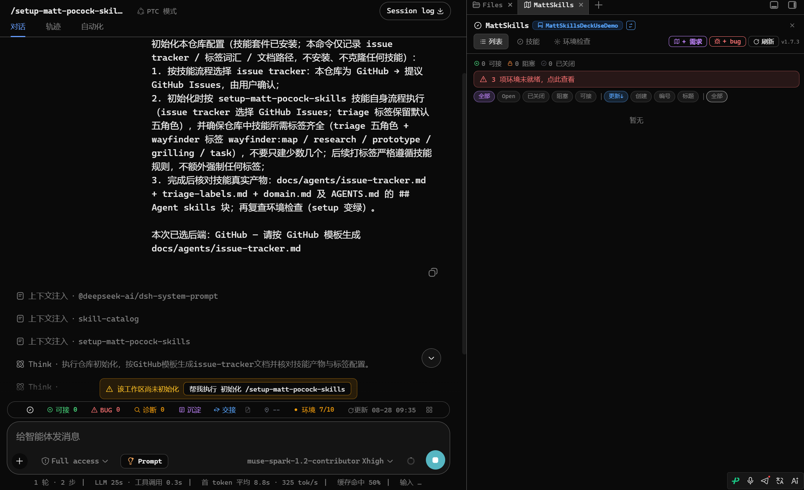<br>第 5 步：等待 AI 执行初始化</td>
    <td valign="top">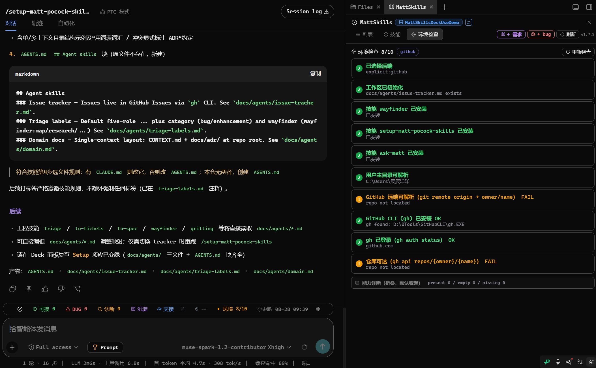<br>第 6 步：环境检测不通过时照提示补齐</td>
  </tr>
</table>

</div>

<h2 align="center"><sub>BOARD</sub><br>任务板列表</h2>

<div align="center">

仓库里的任务不再是流水账：面板把它们按可接、阻塞、已关闭归位，进度走到哪一格一眼看清。每行任务的按钮就是动作入口：点一下，写好的指令填进输入框，确认后再发送。地图类型的行永远置顶，已关闭的收成一行。

**👇 单仓多票和多区并发，两张对照看。**

<table>
  <tr>
    <td valign="top">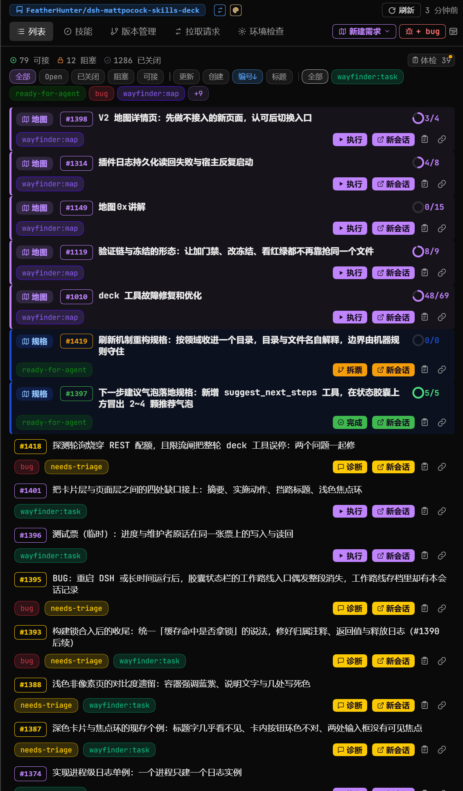<br>单仓多票：可接、阻塞、已关闭归位</td>
    <td valign="top">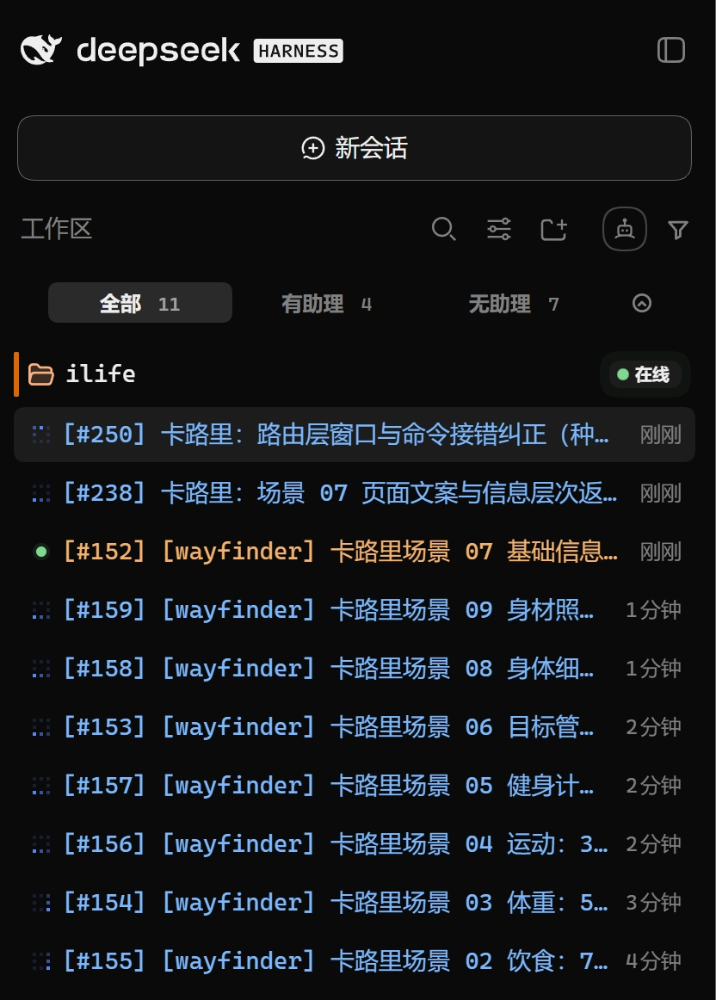<br>多区并发：多工作区多会话同时推进</td>
  </tr>
</table>

</div>

<h2 align="center"><sub>STATUSBAR</sub><br>底部任务栏</h2>

<div align="center">

每条会话输入框下面都有一条胶囊状态栏：可接数量、待修（BUG）数量、诊断、沉淀、交接、环境进度都在上面。点可接、环境等主要分段，即跳到对应面板页，看完即回，不打断手头会话。

**👇 离手最近的操作条和它弹出的工作路线，两张对照看。**

<table>
  <tr>
    <td valign="top">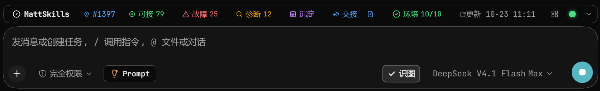<br>输入框区域：可接、故障、诊断、沉淀、交接、环境都在一条上</td>
    <td valign="top">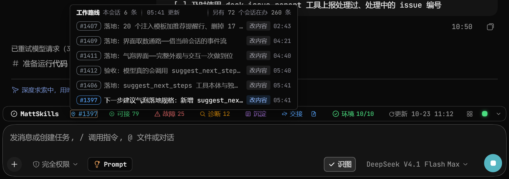<br>工作路线：本会话多条加另有几十个会话在办一目了然</td>
  </tr>
</table>

</div>

<h2 align="center"><sub>DETAIL</sub><br>ISSUE 详情与评论</h2>

<div align="center">

点开任意一条任务，描述、标签、认领人与评论都在面板里排好版，不用跳终端。在底部输入框直接回话，一般只按标签显示其中一个（诊断、修复、讨论、执行），需要另起再点新会话。

**👇 从地图卡片墙到单票详情，两张对照看。**

<table>
  <tr>
    <td valign="top">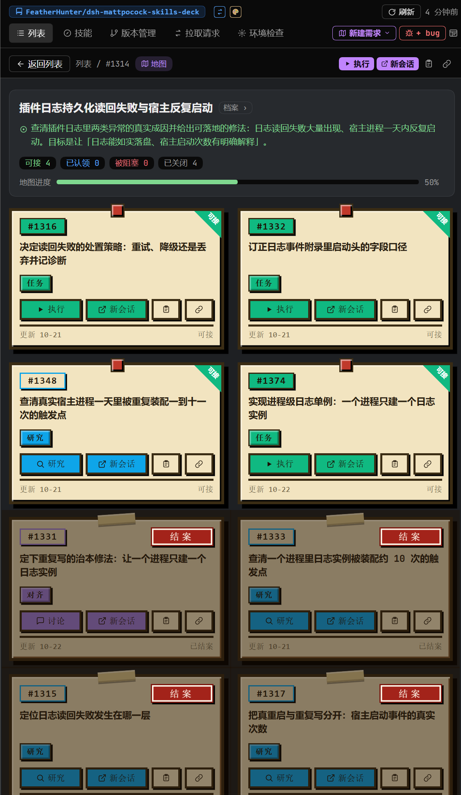<br>地图详情：可接与已结案卡片摆满一墙</td>
    <td valign="top">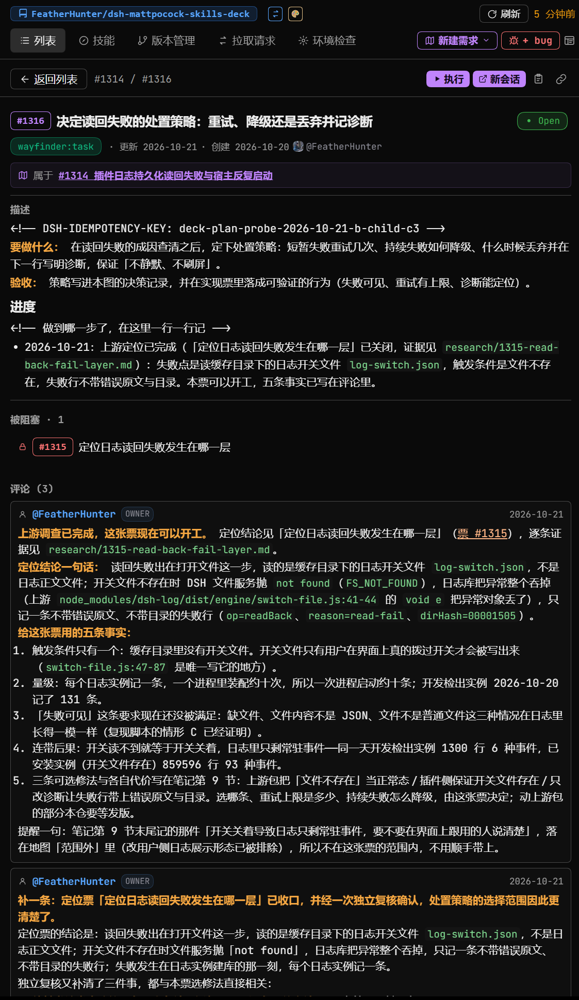<br>单票详情：描述、验收、进度、评论排好版</td>
  </tr>
</table>

</div>

<h2 align="center"><sub>NEW SESSION</sub><br>新会话</h2>

<div align="center">

任何活都能另起干净会话干：详情页顶部点新会话，新会话标题自动起好，承接指令已预填，人只管检查后发送。当前会话不受扰，脏活累活都在新会话里。

**👇 两个入口进同一件事，两张对照看。**

<table>
  <tr>
    <td valign="top">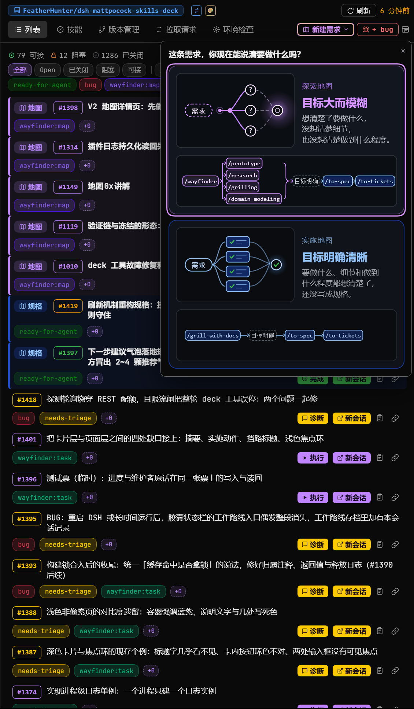<br>右侧面板入口：新建需求弹窗选类型</td>
    <td valign="top">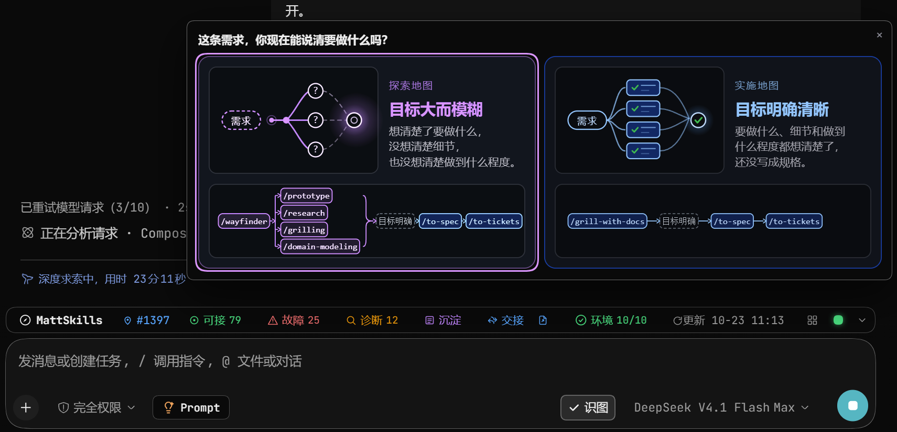<br>胶囊入口：状态栏上同样一点即建</td>
  </tr>
</table>

</div>

<h2 align="center"><sub>SKILLS</sub><br>技能快捷入口</h2>

<div align="center">

随包 27 个技能（快照 v1.3.1）装好即用：面板技能页顶部给通用推荐（默认 /ask-matt），列表一行讲清一个技能的中文用途，点加载就把斜杠指令填进输入框。完整名单与教程见 Matt 官方 [aihero.dev/skills](https://www.aihero.dev/skills)，本插件只讲入口与推荐。

**👇 列表一行讲清用途、详情点开看完整说明。**

<table>
  <tr>
    <td valign="top">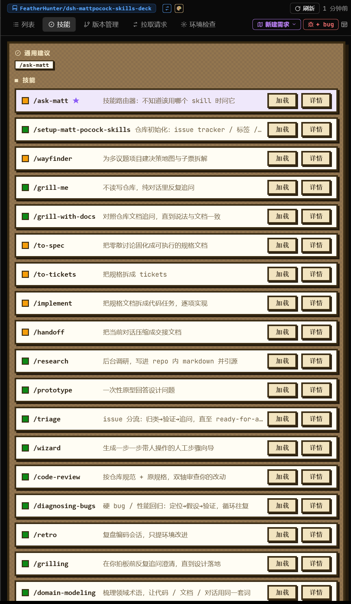<br>技能列表：一行讲清一个技能的中文用途</td>
    <td valign="top">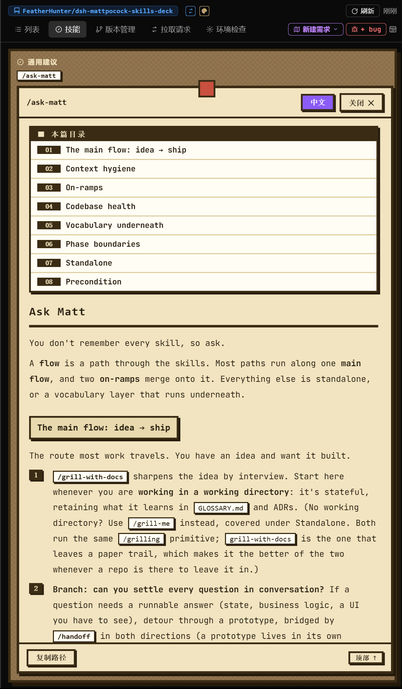<br>技能详情：点开看完整说明再加载</td>
  </tr>
</table>

</div>

<h2 align="center"><sub>BACKENDS</sub><br>多后端切换</h2>

<div align="center">

同一个面板可换跑道：设置页后端选择器列出 GitHub、本地 Markdown、GitLab 与 Other（无后端）逃生舱。切换只换数据源：切换后原数据不可见，原后端数据保留，切回来又可见。新人第一次大多只用一条跑道，知道能换即可。

**👇 换跑道不断数据、跑之前先看环境，两张对照看。**

<table>
  <tr>
    <td valign="top">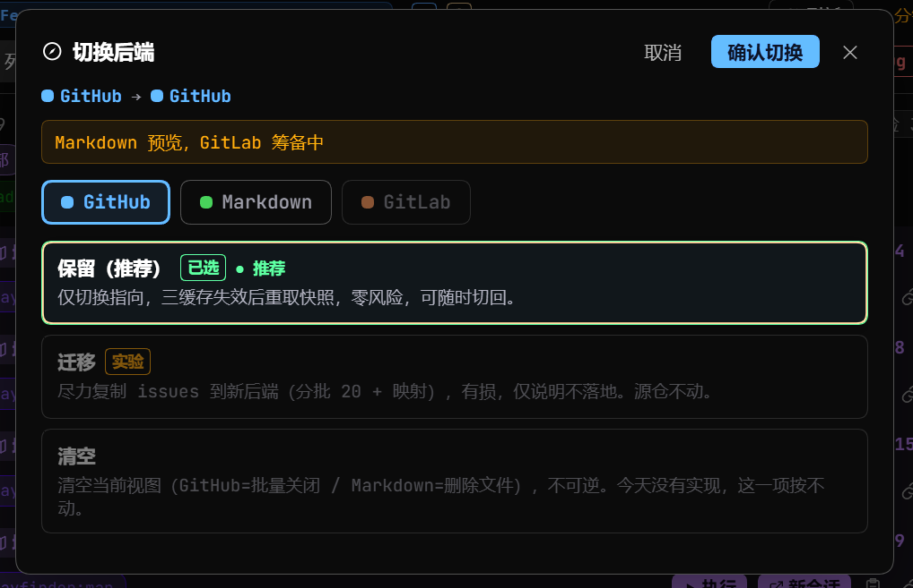<br>切换后端：同面板换跑道、原数据保留切回可见</td>
    <td valign="top">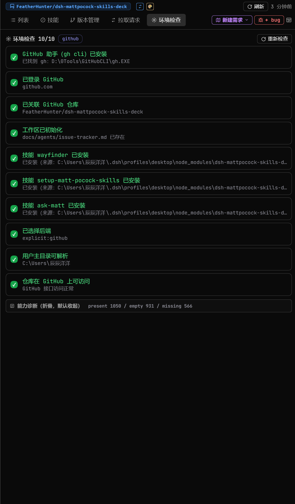<br>环境检查：不通过的项照提示补齐再开工</td>
  </tr>
</table>

</div>

<h2 align="center"><sub>VERSION</sub><br>版本管理</h2>

<div align="center">

改了什么、并行几棵树、提交到哪，三张图一次讲清。

<table>
  <tr>
    <td valign="top">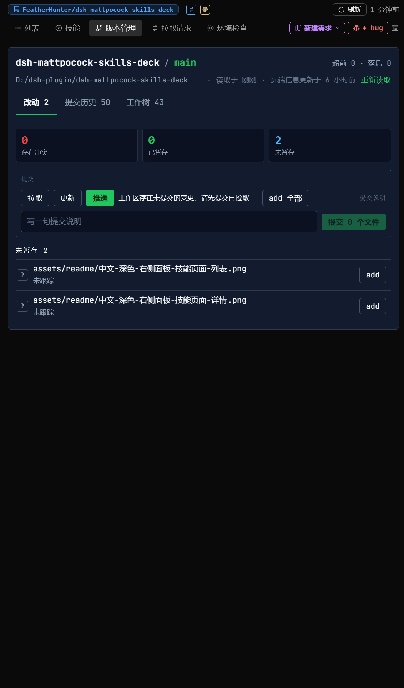<br>改动：本次改了什么</td>
    <td valign="top">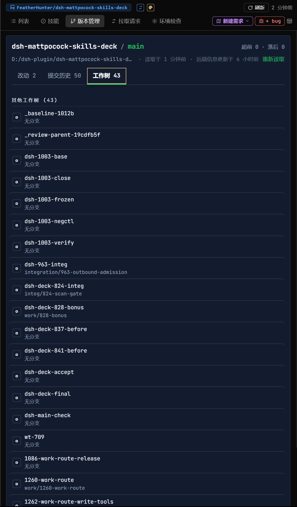<br>工作树：并行几棵树</td>
  </tr>
</table>

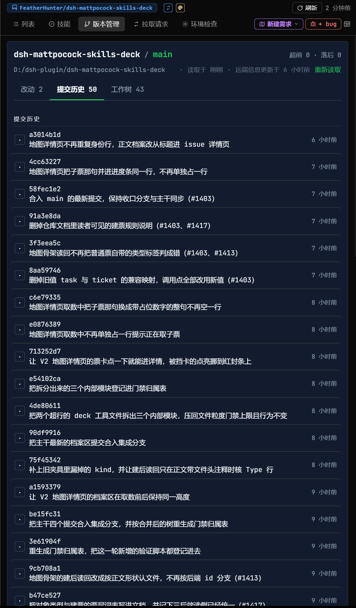

提交历史细节多，单列大图才看得清。

</div>

<h2 align="center"><sub>APPEARANCE</sub><br>设置与外观</h2>

<div align="center">

设置页一次讲清。

<table>
  <tr>
    <td valign="top">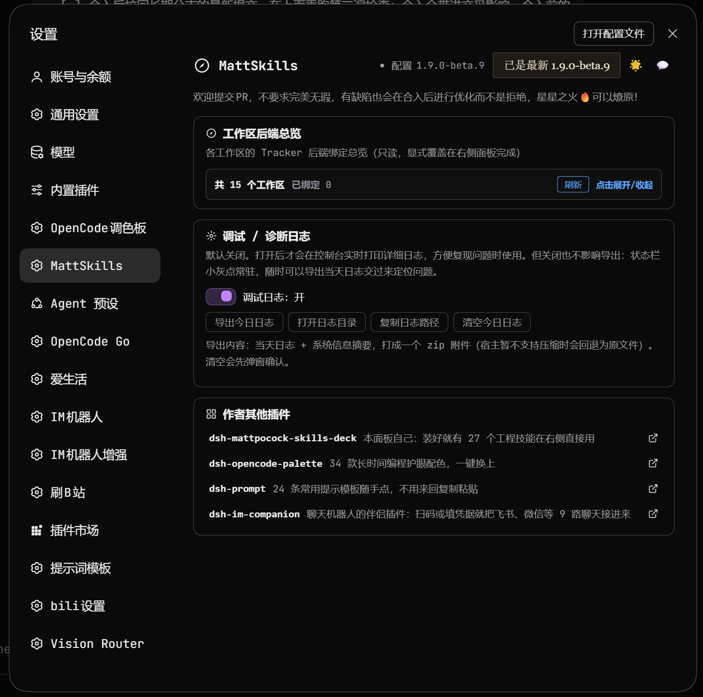<br>设置主页：总览入口都在这里</td>
    <td valign="top">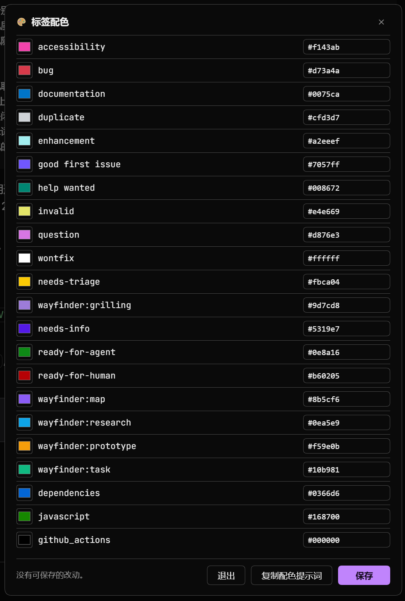<br>调色板：标签颜色随心换</td>
  </tr>
</table>

</div>

<h2 align="center"><sub>FAQ</sub><br>常见问题</h2>

<details open>
<summary>更新之后还是旧版本？</summary>

这是 DSH 桌面端的 pnpm 供应链策略（`minimumReleaseAge`）导致的：刚发布的版本，几个小时内 `dsh plugin update` 和插件市场的「更新」按钮都会静默跳过。更新后请完全退出 DSH 再重开，按 Ctrl+F5 刷新页面；还没更新的话，显式指定官方源装一次：

```bash
dsh plugin --profile web add dsh-mattpocock-skills-deck@latest --registry https://registry.npmjs.org
```

**👇 认准成功回显里的最新版本号即装好；更新后仍显示旧版就完全退出 DSH 重开，并 Ctrl+F5 刷新。**

</details>

<details>
<summary>更新报错找不到新版本（No matching version），地址是镜像源？</summary>

这是镜像源还没有同步到新版本：报错地址写着镜像源（例如 `registry.npmmirror.com`），而新版本已经在官方源上发布，包本身没有漏发。等镜像源同步完成就能正常更新；着急用的话，显式指定官方源装一次（下面这条命令不要去掉末尾的源参数，去掉就会走回镜像源）：

```bash
dsh plugin --profile web add dsh-mattpocock-skills-deck@latest --registry https://registry.npmjs.org
```

桌面应用用户把 `--profile web` 换成 `--profile desktop`。

</details>

<h2 align="center"><sub>JOIN</sub><br>欢迎您加入我们</h2>

<div align="center">

非常欢迎提交PR、共同维护项目，现在迭代中很缺对markdown后端的开发和完善，Gitlab目前无人力开发。

</div>

<h2 align="center"><sub>THANKS</sub><br>致谢</h2>

<div align="left">

感谢每一位提交 Issue、PR 与参与讨论的朋友，是你们让这个插件一点点变好。

<!-- THANKS-TABLE-ZH-START -->
| 贡献者 | 致敬 | 贡献 |
| --- | --- | --- |
| [@pioneerAlone](https://github.com/pioneerAlone) | 🌹🌹🌹🌹🌹🌹 | [#234](https://github.com/FeatherHunter/dsh-mattpocock-skills-deck/issues/234) [#274](https://github.com/FeatherHunter/dsh-mattpocock-skills-deck/issues/274) [#298](https://github.com/FeatherHunter/dsh-mattpocock-skills-deck/issues/298) [#645](https://github.com/FeatherHunter/dsh-mattpocock-skills-deck/issues/645) [#273](https://github.com/FeatherHunter/dsh-mattpocock-skills-deck/pull/273) [#316](https://github.com/FeatherHunter/dsh-mattpocock-skills-deck/pull/316) |
| [@zhengcookie](https://github.com/zhengcookie) | 🌹🌹🌹🌹🌹 | [#960](https://github.com/FeatherHunter/dsh-mattpocock-skills-deck/issues/960) [#1003](https://github.com/FeatherHunter/dsh-mattpocock-skills-deck/issues/1003) [#1160](https://github.com/FeatherHunter/dsh-mattpocock-skills-deck/issues/1160) [#1291](https://github.com/FeatherHunter/dsh-mattpocock-skills-deck/issues/1291) [#1005](https://github.com/FeatherHunter/dsh-mattpocock-skills-deck/discussions/1005) |
| [@Shimmernight](https://github.com/Shimmernight) | 🌹🌹🌹🌹 | [#277](https://github.com/FeatherHunter/dsh-mattpocock-skills-deck/issues/277) [#106](https://github.com/FeatherHunter/dsh-mattpocock-skills-deck/pull/106) [#275](https://github.com/FeatherHunter/dsh-mattpocock-skills-deck/pull/275) [#287](https://github.com/FeatherHunter/dsh-mattpocock-skills-deck/pull/287) |
| [@anupamme](https://github.com/anupamme) | 🌹🌹🌹 | [#727](https://github.com/FeatherHunter/dsh-mattpocock-skills-deck/pull/727) [#728](https://github.com/FeatherHunter/dsh-mattpocock-skills-deck/pull/728) [#1156](https://github.com/FeatherHunter/dsh-mattpocock-skills-deck/pull/1156) |
| [@9agj](https://github.com/9agj) | 🌹🌹🌹 | [#992](https://github.com/FeatherHunter/dsh-mattpocock-skills-deck/issues/992) [#993](https://github.com/FeatherHunter/dsh-mattpocock-skills-deck/issues/993) [#994](https://github.com/FeatherHunter/dsh-mattpocock-skills-deck/issues/994) |
| [@776317107](https://github.com/776317107) | 🌹🌹 | [#1375](https://github.com/FeatherHunter/dsh-mattpocock-skills-deck/issues/1375) [#1376](https://github.com/FeatherHunter/dsh-mattpocock-skills-deck/pull/1376) |
| [@gzy31007](https://github.com/gzy31007) | 🌹🌹 | [#1272](https://github.com/FeatherHunter/dsh-mattpocock-skills-deck/issues/1272) [#1273](https://github.com/FeatherHunter/dsh-mattpocock-skills-deck/issues/1273) |
| [@qq1393950873-bit](https://github.com/qq1393950873-bit) | 🌹🌹 | [#970](https://github.com/FeatherHunter/dsh-mattpocock-skills-deck/issues/970) [#974](https://github.com/FeatherHunter/dsh-mattpocock-skills-deck/pull/974) |
| [@hyperion2144](https://github.com/hyperion2144) | 🌹🌹 | [#110](https://github.com/FeatherHunter/dsh-mattpocock-skills-deck/issues/110) [#646](https://github.com/FeatherHunter/dsh-mattpocock-skills-deck/issues/646) |
| [@arnold117](https://github.com/arnold117) | 🌹🌹 | [#574](https://github.com/FeatherHunter/dsh-mattpocock-skills-deck/issues/574) [#575](https://github.com/FeatherHunter/dsh-mattpocock-skills-deck/pull/575) |
| [@xiSage](https://github.com/xiSage) | 🌹🌹 | [#435](https://github.com/FeatherHunter/dsh-mattpocock-skills-deck/issues/435) [#436](https://github.com/FeatherHunter/dsh-mattpocock-skills-deck/discussions/436) |
| [@angenet](https://github.com/angenet) | 🌹🌹 | [#262](https://github.com/FeatherHunter/dsh-mattpocock-skills-deck/issues/262) [#295](https://github.com/FeatherHunter/dsh-mattpocock-skills-deck/issues/295) |
| [@lilincen](https://github.com/lilincen) | 🌹 | [#1301](https://github.com/FeatherHunter/dsh-mattpocock-skills-deck/discussions/1301) |
| [@WDXXZH](https://github.com/WDXXZH) | 🌹 | [#1137](https://github.com/FeatherHunter/dsh-mattpocock-skills-deck/issues/1137) |
| [@Drayee](https://github.com/Drayee) | 🌹 | [#1101](https://github.com/FeatherHunter/dsh-mattpocock-skills-deck/issues/1101) |
| [@30892096](https://github.com/30892096) | 🌹 | [#1100](https://github.com/FeatherHunter/dsh-mattpocock-skills-deck/issues/1100) |
| [@fishke22](https://github.com/fishke22) | 🌹 | [#1000](https://github.com/FeatherHunter/dsh-mattpocock-skills-deck/pull/1000) |
| [@jack2jiehua](https://github.com/jack2jiehua) | 🌹 | [#930](https://github.com/FeatherHunter/dsh-mattpocock-skills-deck/issues/930) |
| [@asesr](https://github.com/asesr) | 🌹 | [#926](https://github.com/FeatherHunter/dsh-mattpocock-skills-deck/issues/926) |
| [@SKADI0718](https://github.com/SKADI0718) | 🌹 | [#856](https://github.com/FeatherHunter/dsh-mattpocock-skills-deck/issues/856) |
| [@li873582595](https://github.com/li873582595) | 🌹 | [#835](https://github.com/FeatherHunter/dsh-mattpocock-skills-deck/issues/835) |
| [@zerocodefast](https://github.com/zerocodefast) | 🌹 | [#823](https://github.com/FeatherHunter/dsh-mattpocock-skills-deck/issues/823) |
| [@seameafst](https://github.com/seameafst) | 🌹 | [#793](https://github.com/FeatherHunter/dsh-mattpocock-skills-deck/issues/793) |
| [@SbDonger](https://github.com/SbDonger) | 🌹 | [#640](https://github.com/FeatherHunter/dsh-mattpocock-skills-deck/issues/640) |
| [@snmtg1008](https://github.com/snmtg1008) | 🌹 | [#476](https://github.com/FeatherHunter/dsh-mattpocock-skills-deck/issues/476) |
| [@dis0neplay](https://github.com/dis0neplay) | 🌹 | [#493](https://github.com/FeatherHunter/dsh-mattpocock-skills-deck/pull/493) |
| [@tafcear](https://github.com/tafcear) | 🌹 | [#422](https://github.com/FeatherHunter/dsh-mattpocock-skills-deck/issues/422) |
| [@21967201](https://github.com/21967201) | 🌹 | [#321](https://github.com/FeatherHunter/dsh-mattpocock-skills-deck/pull/321) |
| [@271912980](https://github.com/271912980) | 🌹 | [#257](https://github.com/FeatherHunter/dsh-mattpocock-skills-deck/issues/257) |
<!-- THANKS-TABLE-ZH-END -->

也感谢在评论区与讨论区留下想法的每一位朋友。如果你也遇到了问题或有新想法，欢迎直接提 Issue 或发起讨论。

</div>

<h2 align="center"><sub>CONNECT</sub><br>加入我们</h2>

<div align="center">

扫码加入话题群——二维码永久有效。日常闲聊与快速答疑走群里，Bug 与需求请直接提 ISSUE，更高效可追溯。


<br>
<strong>加入话题群</strong>
<br>
<sub>dsh-mattpocock-skills · 该二维码永久有效</sub>

</div>

<div align="center">

<a href="https://featherhunter.github.io/dsh-mattpocock-skills-deck/star-history.html">
  <picture>
    <source media="(prefers-color-scheme: dark)" srcset="https://raw.githubusercontent.com/FeatherHunter/dsh-mattpocock-skills-deck/main/docs/star-history-dark.svg?v=20261022" />
    <source media="(prefers-color-scheme: light)" srcset="https://raw.githubusercontent.com/FeatherHunter/dsh-mattpocock-skills-deck/main/docs/star-history-light.svg?v=20261022" />
    
  </picture>
</a>

</div>

<h2 align="center"><sub>MORE</sub><br>作者的其他作品</h2>

<div align="left">

喜欢这个插件的话，这些可能你也用得上：

**[dsh-opencode-palette](https://github.com/FeatherHunter/dsh-opencode-palette)** —— 38 款 opencode 经典配色 + 20+自定义主题 一键换装 DSH。

**[dsh-prompt](https://github.com/FeatherHunter/dsh-prompt)** —— 经常反复重复的模板化提示词，存成自定义模板，选中后直接注入，不再需要耗费精力。

**[dsh-im-companion](https://github.com/FeatherHunter/dsh-im-companion)** —— 给 dsh-im 加了「助理」和「家」的概念。

**[ilife](https://github.com/FeatherHunter/ilife)** —— ⚠️建设中⚠️爱生活：居家生活套件，记账、运动、饮食、体重、食谱、物品管理、作息规划、备忘录等。

</div>
