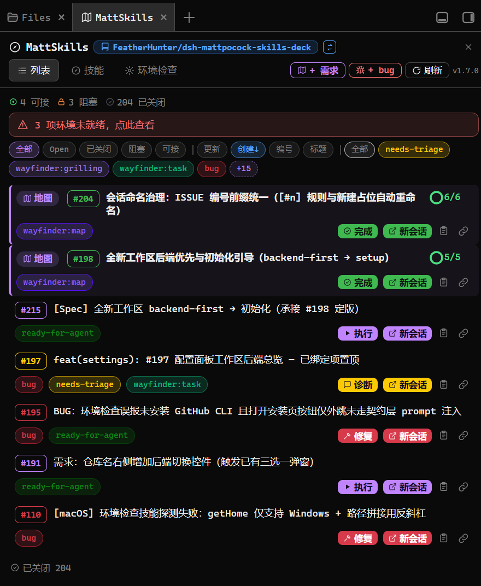
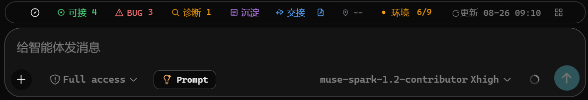
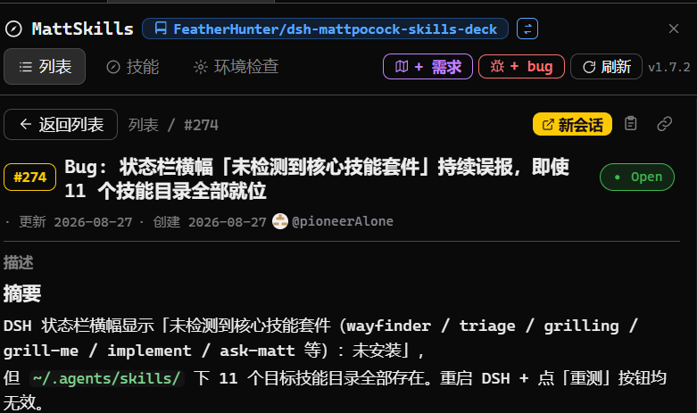
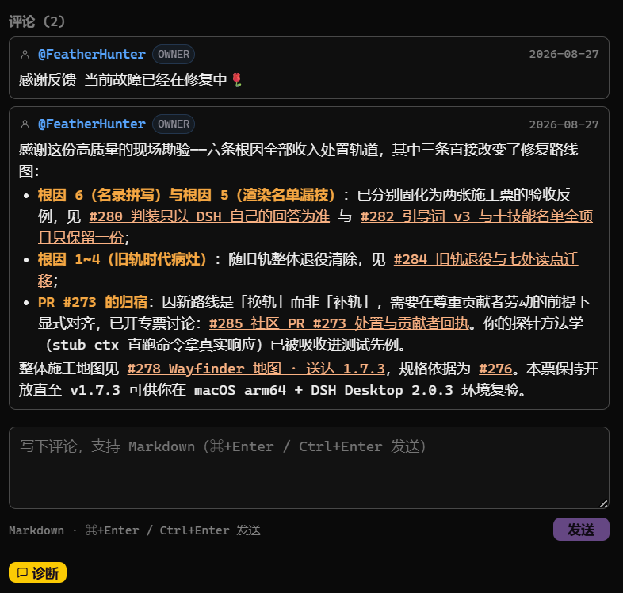
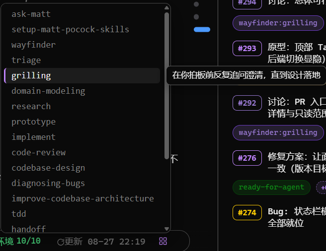

<h1 align="center">dsh-mattpocock-skills-deck</h1>

<div align="center">

[中文](../README.md) · **English**

**Part the fog of war, see the end — MattSkillsDeck handles the rest.**  
A playable task board for [mattpocock/skills](https://github.com/mattpocock/skills) in DSH — visible, dispatchable, trackable.

*Your ⭐ is the brightest star in my night sky.*

[](https://www.npmjs.com/package/dsh-mattpocock-skills-deck) [](https://www.npmjs.com/package/dsh-mattpocock-skills-deck) [](https://github.com/FeatherHunter/dsh-mattpocock-skills-deck/commits/main) [](https://github.com/FeatherHunter/dsh-mattpocock-skills-deck/graphs/commit-activity) [](../LICENSE) [](https://github.com/mattpocock/skills) [](https://github.com/FeatherHunter/dsh-mattpocock-skills-deck/issues) [](ROADMAP.md)

<strong>👇 A mission board you can see, and act on.</strong>



**Install in 30 seconds.**

</div>

<h2 align="center"><sub>INSTALL</sub><br>Install</h2>

<div align="center">

One prerequisite: [DSH](https://www.npmjs.com/package/@deepseek-ai/dsh) (DeepSeek Harness, an AI coding desktop). You give instructions, the AI does the work — and MattSkillsDeck turns that work into missions on a panel.

The repo your task board is bound to needs write access: creating labels requires push access, and labeling tickets requires triage access or higher. With read-only access you can still create and read tickets, but label backfill, label flow, and wayfinder labels are unavailable.

</div>

```bash
# ① Install the DSH CLI (skip if already installed)
npm install -g @deepseek-ai/dsh

# ② Install MattSkillsDeck — --profile is required: target the profile matching the DSH
#    entry you actually use (a wrong profile = the plugin never loads, restarts won't help)
dsh plugin --profile desktop add dsh-mattpocock-skills-deck   # DSH Desktop app (most users)
# dsh plugin --profile web add dsh-mattpocock-skills-deck     # self-started web server (dsh web)
# Pin to latest for extra stability (currently 1.9.0-beta.33):
# dsh plugin --profile desktop add dsh-mattpocock-skills-deck@1.9.0-beta.33 --registry https://registry.npmjs.org

# ③ That's it — the panel opens in DSH's own right sidebar (no third-party plugin needed)
```

<div align="center">

One restart of the matching DSH entry and it works — zero config. Desktop app: fully quit and reopen DSH Desktop. Web server: restart dsh web, then refresh the page.

**Heavily optimized right-panel performance: click-to-visible content, 5075 ms down to 193 ms on a real machine — about 96.2% faster (about 26x).**

</div>

<details>
<summary>Let your AI install it for you</summary>

Paste this to your AI — it will read the repo, check the environment, and install what's missing:

```text
Please install the DeepSeek Harness plugin dsh-mattpocock-skills-deck (MattSkillsDeck).
Read the repo README first: https://github.com/FeatherHunter/dsh-mattpocock-skills-deck
First figure out which profile matches the DSH entry I actually use (DSH Desktop app → desktop; self-started web server → web) and install into that profile.
Then check the environment and install as needed (skip what's already installed), and report back briefly.
```

</details>

<details>
<summary>No global install / when updates don't take effect</summary>

The examples below use the web profile — DSH Desktop app users: replace every `--profile web` with `--profile desktop`.

```bash
# Install a pinned version
dsh plugin --profile web add dsh-mattpocock-skills-deck@1.9.0-beta.33 --registry https://registry.npmjs.org

# No global install (pin a version like above for extra safety)
npx --yes @deepseek-ai/dsh plugin --profile web add dsh-mattpocock-skills-deck

# When an update is silently skipped, point at the official registry
dsh plugin --profile web add dsh-mattpocock-skills-deck@latest --registry https://registry.npmjs.org
```

</details>

Upgrade · uninstall (desktop-profile users: replace `--profile web` with `--profile desktop`):

```bash
dsh plugin --profile web update dsh-mattpocock-skills-deck   # upgrade
dsh plugin --profile web remove dsh-mattpocock-skills-deck   # uninstall
```

<h2 align="center"><sub>WHY</sub><br>Why MattSkillsDeck</h2>

<div align="center">

Matt Pocock's [skills](https://github.com/mattpocock/skills) are excellent: wayfinder draws a map and walks you through the fog to the goal. But once the map is drawn — **how do you walk each step under your feet?**

MattSkillsDeck adds a mission system on top of that map:

**A mission board you can see** — repo ISSUES stop being a flat log. MattSkillsDeck moves them into the DSH sidebar: open, blocked, closed in their own lanes, progress rings right where you glance.

**A workbench that acts** — every mission card is a button: diagnose, fix, run, new session. One click and the AI goes to work; how far it got, where it stalled, all written on the card.

The map owns the goal. MattSkillsDeck owns the steps.

<strong>👇 The task bar lives at the bottom of DSH: open, blocked, archived, handed off — one strip.</strong>



</div>

<h2 align="center"><sub>IN ACTION</sub><br>In action</h2>

<div align="center">

<strong>👇 Open an issue: description, author, one-click new session.</strong>



<strong>👇 Never touch the terminal: comment, respond to issues, run diagnostics in the panel.</strong>



<strong>👇 Far right of the task bar: every Matt skill, one click away.</strong>



Matt's official skills site (docs and tutorials): [aihero.dev/skills](https://www.aihero.dev/skills)

</div>

<h2 align="center"><sub>FAQ</sub><br>FAQ</h2>

<details open>
<summary>Still on the old version after updating?</summary>

That's the pnpm supply-chain policy (`minimumReleaseAge`) in the DSH desktop app: freshly published versions are silently skipped by `dsh plugin update` and the marketplace's update button for a few hours. Fully quit DSH and reopen, then hard-refresh with Ctrl+F5. If it still hasn't updated, install explicitly from the official registry:

```bash
dsh plugin --profile web add dsh-mattpocock-skills-deck@latest --registry https://registry.npmjs.org
```

</details>

<details>
<summary>Update fails with "No matching version" pointing at a mirror registry?</summary>

The mirror registry has not synced the new release yet: the error URL names a mirror (for example `registry.npmmirror.com`), while the new version is already published on the official registry — nothing failed to publish. Updating works again once the mirror finishes syncing. If you need the new version right away, install explicitly from the official registry (keep the trailing registry parameter in the command below — dropping it sends you back to the mirror):

```bash
dsh plugin --profile web add dsh-mattpocock-skills-deck@latest --registry https://registry.npmjs.org
```

Desktop app users: replace `--profile web` with `--profile desktop`.

</details>

<details>
<summary>Can I use it on a narrow window?</summary>

Yes. The panel opens in DSH's own right sidebar: the mission list is on the left of that column and the details open beside it.

</details>

<h2 align="center"><sub>ARCHITECTURE</sub><br>Architecture</h2>

<div align="center">

Want to see how the code is put together? This interactive diagram was generated by AI — it lays out the overall structure, data flow and key states, with dark and light themes and image export.

[Open online (recommended)](https://featherhunter.github.io/dsh-mattpocock-skills-deck/architecture/MattSkills-architecture.html) · or just open [`architecture/MattSkills-architecture.html`](architecture/MattSkills-architecture.html) locally in your browser — no server needed. The source data lives next to it as `mattskills.architecture.json`, with more write-ups in the `*.md` files in the same folder.

</div>

<h2 align="center"><sub>DEVELOPMENT</sub><br>Development</h2>

Edit `src/` only — `client.js`, `host.js` at the repo root and `package/lib/` are build artifacts, don't touch them.

```bash
node scripts/build.mjs      # build (repo artifacts only, never touches an installed DSH)
npm run test:smoke          # smoke tests
npm run verify              # contract checks
```

The current build / verify workflow lives in [docs/agents/verification.md](agents/verification.md); the historical walkthrough is kept in [DEV-WORKFLOW.md](workflow/DEV-WORKFLOW.md).

<!-- MORE-START -->
<h2 align="center"><sub>MORE</sub><br>More from the author</h2>

<div align="left">

If you like this plugin, these might help too:

**[dsh-prompt](https://github.com/FeatherHunter/dsh-prompt)** — The boilerplate prompts you keep retyping, saved as custom templates and injected on selection — no more wasted effort.

**[dsh-opencode-palette](https://github.com/FeatherHunter/dsh-opencode-palette)** — 38 classic opencode themes + 20+ custom themes — reskin DSH in one click.

**[dsh-im-companion](https://github.com/FeatherHunter/dsh-im-companion)** — Adds the ideas of an “assistant” and a “home” to dsh-im.

**[ilife](https://github.com/FeatherHunter/ilife)** — ⚠️Work in progress⚠️ iLife, the home-life suite: bookkeeping, exercise, diet, weight, recipes, item management, schedule planning, memos and more.

</div>
<!-- MORE-END -->

---

Questions or ideas? [Open an issue](https://github.com/FeatherHunter/dsh-mattpocock-skills-deck/issues) or start a thread in [discussions](https://github.com/FeatherHunter/dsh-mattpocock-skills-deck/discussions)

A personal project, not affiliated with [mattpocock/skills](https://github.com/mattpocock/skills).
MIT © FeatherHunter

</div>

<h2 align="center"><sub>THANKS</sub><br>Thanks</h2>

<div align="left">

Thanks to everyone who opened an issue, sent a PR, or joined a discussion — you made this plugin better bit by bit.

<!-- THANKS-TABLE-EN-START -->
| Contributor | Tribute | Contributions |
| --- | --- | --- |
| [@pioneerAlone](https://github.com/pioneerAlone) | 🌹🌹🌹🌹🌹🌹 | [#234](https://github.com/FeatherHunter/dsh-mattpocock-skills-deck/issues/234) [#274](https://github.com/FeatherHunter/dsh-mattpocock-skills-deck/issues/274) [#298](https://github.com/FeatherHunter/dsh-mattpocock-skills-deck/issues/298) [#645](https://github.com/FeatherHunter/dsh-mattpocock-skills-deck/issues/645) [#273](https://github.com/FeatherHunter/dsh-mattpocock-skills-deck/pull/273) [#316](https://github.com/FeatherHunter/dsh-mattpocock-skills-deck/pull/316) |
| [@zhengcookie](https://github.com/zhengcookie) | 🌹🌹🌹🌹🌹 | [#960](https://github.com/FeatherHunter/dsh-mattpocock-skills-deck/issues/960) [#1003](https://github.com/FeatherHunter/dsh-mattpocock-skills-deck/issues/1003) [#1160](https://github.com/FeatherHunter/dsh-mattpocock-skills-deck/issues/1160) [#1291](https://github.com/FeatherHunter/dsh-mattpocock-skills-deck/issues/1291) [#1005](https://github.com/FeatherHunter/dsh-mattpocock-skills-deck/discussions/1005) |
| [@Shimmernight](https://github.com/Shimmernight) | 🌹🌹🌹🌹 | [#277](https://github.com/FeatherHunter/dsh-mattpocock-skills-deck/issues/277) [#106](https://github.com/FeatherHunter/dsh-mattpocock-skills-deck/pull/106) [#275](https://github.com/FeatherHunter/dsh-mattpocock-skills-deck/pull/275) [#287](https://github.com/FeatherHunter/dsh-mattpocock-skills-deck/pull/287) |
| [@anupamme](https://github.com/anupamme) | 🌹🌹🌹 | [#727](https://github.com/FeatherHunter/dsh-mattpocock-skills-deck/pull/727) [#728](https://github.com/FeatherHunter/dsh-mattpocock-skills-deck/pull/728) [#1156](https://github.com/FeatherHunter/dsh-mattpocock-skills-deck/pull/1156) |
| [@9agj](https://github.com/9agj) | 🌹🌹🌹 | [#992](https://github.com/FeatherHunter/dsh-mattpocock-skills-deck/issues/992) [#993](https://github.com/FeatherHunter/dsh-mattpocock-skills-deck/issues/993) [#994](https://github.com/FeatherHunter/dsh-mattpocock-skills-deck/issues/994) |
| [@SAXEM1997](https://github.com/SAXEM1997) | 🌹🌹 | [#1566](https://github.com/FeatherHunter/dsh-mattpocock-skills-deck/issues/1566) [#1612](https://github.com/FeatherHunter/dsh-mattpocock-skills-deck/issues/1612) |
| [@Drayee](https://github.com/Drayee) | 🌹🌹 | [#1101](https://github.com/FeatherHunter/dsh-mattpocock-skills-deck/issues/1101) [#1606](https://github.com/FeatherHunter/dsh-mattpocock-skills-deck/issues/1606) |
| [@q4452542007](https://github.com/q4452542007) | 🌹🌹 | [#1555](https://github.com/FeatherHunter/dsh-mattpocock-skills-deck/issues/1555) [#1578](https://github.com/FeatherHunter/dsh-mattpocock-skills-deck/discussions/1578) |
| [@Niefee](https://github.com/Niefee) | 🌹🌹 | [#1516](https://github.com/FeatherHunter/dsh-mattpocock-skills-deck/issues/1516) [#1569](https://github.com/FeatherHunter/dsh-mattpocock-skills-deck/issues/1569) |
| [@654970](https://github.com/654970) | 🌹🌹 | [#1375](https://github.com/FeatherHunter/dsh-mattpocock-skills-deck/issues/1375) [#1481](https://github.com/FeatherHunter/dsh-mattpocock-skills-deck/issues/1481) |
| [@xingmulee](https://github.com/xingmulee) | 🌹🌹 | [#1421](https://github.com/FeatherHunter/dsh-mattpocock-skills-deck/issues/1421) [#1422](https://github.com/FeatherHunter/dsh-mattpocock-skills-deck/issues/1422) |
| [@776317107](https://github.com/776317107) | 🌹🌹 | [#1375](https://github.com/FeatherHunter/dsh-mattpocock-skills-deck/issues/1375) [#1376](https://github.com/FeatherHunter/dsh-mattpocock-skills-deck/pull/1376) |
| [@gzy31007](https://github.com/gzy31007) | 🌹🌹 | [#1272](https://github.com/FeatherHunter/dsh-mattpocock-skills-deck/issues/1272) [#1273](https://github.com/FeatherHunter/dsh-mattpocock-skills-deck/issues/1273) |
| [@qq1393950873-bit](https://github.com/qq1393950873-bit) | 🌹🌹 | [#970](https://github.com/FeatherHunter/dsh-mattpocock-skills-deck/issues/970) [#974](https://github.com/FeatherHunter/dsh-mattpocock-skills-deck/pull/974) |
| [@hyperion2144](https://github.com/hyperion2144) | 🌹🌹 | [#110](https://github.com/FeatherHunter/dsh-mattpocock-skills-deck/issues/110) [#646](https://github.com/FeatherHunter/dsh-mattpocock-skills-deck/issues/646) |
| [@arnold117](https://github.com/arnold117) | 🌹🌹 | [#574](https://github.com/FeatherHunter/dsh-mattpocock-skills-deck/issues/574) [#575](https://github.com/FeatherHunter/dsh-mattpocock-skills-deck/pull/575) |
| [@tafcear](https://github.com/tafcear) | 🌹🌹 | [#422](https://github.com/FeatherHunter/dsh-mattpocock-skills-deck/issues/422) [#432](https://github.com/FeatherHunter/dsh-mattpocock-skills-deck/issues/432) |
| [@xiSage](https://github.com/xiSage) | 🌹🌹 | [#435](https://github.com/FeatherHunter/dsh-mattpocock-skills-deck/issues/435) [#436](https://github.com/FeatherHunter/dsh-mattpocock-skills-deck/discussions/436) |
| [@angenet](https://github.com/angenet) | 🌹🌹 | [#262](https://github.com/FeatherHunter/dsh-mattpocock-skills-deck/issues/262) [#295](https://github.com/FeatherHunter/dsh-mattpocock-skills-deck/issues/295) |
| [@Ba7nice](https://github.com/Ba7nice) | 🌹 | [#1733](https://github.com/FeatherHunter/dsh-mattpocock-skills-deck/issues/1733) |
| [@shadapang](https://github.com/shadapang) | 🌹 | [#1672](https://github.com/FeatherHunter/dsh-mattpocock-skills-deck/issues/1672) |
| [@CypressStar](https://github.com/CypressStar) | 🌹 | [#1671](https://github.com/FeatherHunter/dsh-mattpocock-skills-deck/issues/1671) |
| [@yzysdq](https://github.com/yzysdq) | 🌹 | [#1621](https://github.com/FeatherHunter/dsh-mattpocock-skills-deck/issues/1621) |
| [@SupingZhou](https://github.com/SupingZhou) | 🌹 | [#1598](https://github.com/FeatherHunter/dsh-mattpocock-skills-deck/issues/1598) |
| [@danyanp](https://github.com/danyanp) | 🌹 | [#1595](https://github.com/FeatherHunter/dsh-mattpocock-skills-deck/issues/1595) |
| [@Iwassoobsessedwith](https://github.com/Iwassoobsessedwith) | 🌹 | [#1568](https://github.com/FeatherHunter/dsh-mattpocock-skills-deck/issues/1568) |
| [@TangSuann](https://github.com/TangSuann) | 🌹 | [#1505](https://github.com/FeatherHunter/dsh-mattpocock-skills-deck/issues/1505) |
| [@nolifeking0916](https://github.com/nolifeking0916) | 🌹 | [#1504](https://github.com/FeatherHunter/dsh-mattpocock-skills-deck/issues/1504) |
| [@ACGNnsj](https://github.com/ACGNnsj) | 🌹 | [#1498](https://github.com/FeatherHunter/dsh-mattpocock-skills-deck/issues/1498) |
| [@GuanpengLu](https://github.com/GuanpengLu) | 🌹 | [#1478](https://github.com/FeatherHunter/dsh-mattpocock-skills-deck/pull/1478) |
| [@zyf0625-990](https://github.com/zyf0625-990) | 🌹 | [#1476](https://github.com/FeatherHunter/dsh-mattpocock-skills-deck/issues/1476) |
| [@Lichxier](https://github.com/Lichxier) | 🌹 | [#1435](https://github.com/FeatherHunter/dsh-mattpocock-skills-deck/issues/1435) |
| [@mdc707](https://github.com/mdc707) | 🌹 | [#1394](https://github.com/FeatherHunter/dsh-mattpocock-skills-deck/discussions/1394) |
| [@firewfly](https://github.com/firewfly) | 🌹 | [#1392](https://github.com/FeatherHunter/dsh-mattpocock-skills-deck/issues/1392) |
| [@lilincen](https://github.com/lilincen) | 🌹 | [#1301](https://github.com/FeatherHunter/dsh-mattpocock-skills-deck/discussions/1301) |
| [@2980691758](https://github.com/2980691758) | 🌹 | [#998](https://github.com/FeatherHunter/dsh-mattpocock-skills-deck/issues/998) |
| [@WDXXZH](https://github.com/WDXXZH) | 🌹 | [#1137](https://github.com/FeatherHunter/dsh-mattpocock-skills-deck/issues/1137) |
| [@30892096](https://github.com/30892096) | 🌹 | [#1100](https://github.com/FeatherHunter/dsh-mattpocock-skills-deck/issues/1100) |
| [@fishke22](https://github.com/fishke22) | 🌹 | [#1000](https://github.com/FeatherHunter/dsh-mattpocock-skills-deck/pull/1000) |
| [@jack2jiehua](https://github.com/jack2jiehua) | 🌹 | [#930](https://github.com/FeatherHunter/dsh-mattpocock-skills-deck/issues/930) |
| [@asesr](https://github.com/asesr) | 🌹 | [#926](https://github.com/FeatherHunter/dsh-mattpocock-skills-deck/issues/926) |
| [@SKADI0718](https://github.com/SKADI0718) | 🌹 | [#856](https://github.com/FeatherHunter/dsh-mattpocock-skills-deck/issues/856) |
| [@li873582595](https://github.com/li873582595) | 🌹 | [#835](https://github.com/FeatherHunter/dsh-mattpocock-skills-deck/issues/835) |
| [@zerocodefast](https://github.com/zerocodefast) | 🌹 | [#823](https://github.com/FeatherHunter/dsh-mattpocock-skills-deck/issues/823) |
| [@seameafst](https://github.com/seameafst) | 🌹 | [#793](https://github.com/FeatherHunter/dsh-mattpocock-skills-deck/issues/793) |
| [@SbDonger](https://github.com/SbDonger) | 🌹 | [#640](https://github.com/FeatherHunter/dsh-mattpocock-skills-deck/issues/640) |
| [@snmtg1008](https://github.com/snmtg1008) | 🌹 | [#476](https://github.com/FeatherHunter/dsh-mattpocock-skills-deck/issues/476) |
| [@dis0neplay](https://github.com/dis0neplay) | 🌹 | [#493](https://github.com/FeatherHunter/dsh-mattpocock-skills-deck/pull/493) |
| [@21967201](https://github.com/21967201) | 🌹 | [#321](https://github.com/FeatherHunter/dsh-mattpocock-skills-deck/pull/321) |
| [@271912980](https://github.com/271912980) | 🌹 | [#257](https://github.com/FeatherHunter/dsh-mattpocock-skills-deck/issues/257) |
<!-- THANKS-TABLE-EN-END -->

And thanks to everyone who left thoughts in comments and discussions. If you hit a problem or have an idea, feel free to open an issue or start a discussion.

</div>

<!-- CONTACT-START -->
<h2 align="center"><sub>CONNECT</sub><br>Feedback and Contact</h2>

<div align="center">

👏Welcome PRs and issues. A single spark can start a prairie fire 🔥. Any suggestion, opinion, idea or rant — come join the group and talk.

<table align="center"><tr><td align="center"><b>Feishu Group (Main)</b></td><td align="center"><b>QQ Group (New)</b></td><td align="center"><b>WeChat Group (New)</b></td></tr><tr><td></td><td></td><td></td></tr></table>

</div>
<!-- CONTACT-END -->

<!-- STAR-HISTORY-START -->
<div align="center">

<a href="https://featherhunter.github.io/dsh-mattpocock-skills-deck/star-history.html">
  <picture>
    <source media="(prefers-color-scheme: dark)" srcset="https://raw.githubusercontent.com/FeatherHunter/dsh-mattpocock-skills-deck/main/docs/star-history-dark.svg?v=202610310000" />
    <source media="(prefers-color-scheme: light)" srcset="https://raw.githubusercontent.com/FeatherHunter/dsh-mattpocock-skills-deck/main/docs/star-history-light.svg?v=202610310000" />
  
  </picture>
</a>

</div>
<!-- STAR-HISTORY-END -->
