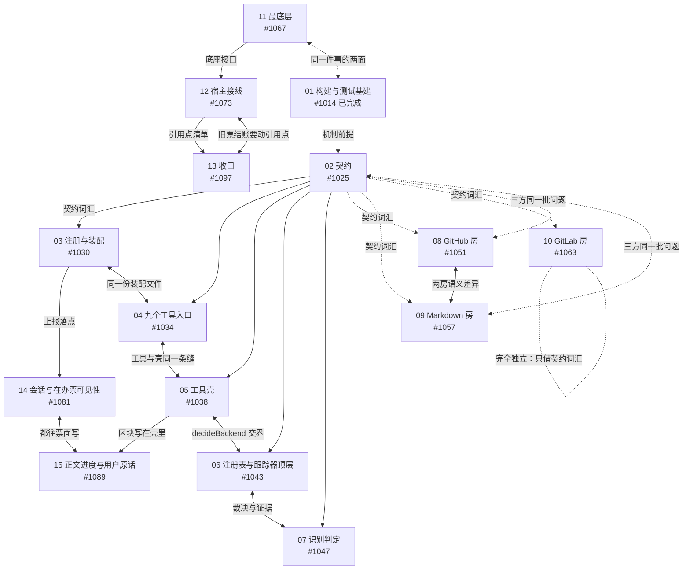

# #1010 · 15 张讨论票的相互影响图

写这份文件的原因：每张地图都有一张讨论票，动手之前要先讨论清楚。维护者问的是——这些讨论票之间，
哪些是前提关系（先定一张，另一张才能定）、哪些是交叠关系（同一个问题被两张图都碰到，必须一起定口径）、
哪些完全独立（可以随时开，互不影响）。答案会影响他先回答哪一张、什么时候回答。

这份文件只讲「讨论层」的影响，不讲「开发票」的先后。开发票的先后已经由跟踪器里的阻塞边表达，
讨论层没有边可依——跟踪器的 `blocked_by` 只能看出「有没有人占着同一批文件」，
看不出「另一张讨论票的结论会不会改写这张的前提」。这正是需要人判断、也是这份文件要补上的东西。

## 一、十五张讨论票

| 图 | 地图 | 讨论票 | 这张讨论要定什么 |
| --- | --- | --- | --- |
| 01 | #1013 构建与测试基建 | **#1014**（已完成） | TypeScript 怎么进构建与测试：Node 下限、装载钩子、门禁换轨、类型检查与棘轮、产物落点、四核搬家、金标准夹具、日志门禁、全程索引 |
| 02 | #1024 契约 | **#1025** | 契约收尾怎么做：`getRepoPermissions` 升进契约、契约门禁收尾、被并行会话改过两轮之后怎么合并 |
| 03 | #1029 注册与装配 | **#1030** | 名字怎么进对话：工具注册路径、装配时递入什么、`decideBackend` 这类硬依赖放在哪 |
| 04 | #1033 九个工具入口 | **#1034** | 工具对外长什么样：九个工具入口的输入、输出、错误形状先定死 |
| 05 | #1037 工具壳 | **#1038** | 纯度线怎么划：哪些是纯规则、哪些摸宿主；共用壳与纯逻辑怎么分家 |
| 06 | #1042 注册表与跟踪器顶层 | **#1043** | 选后端与裁决：注册表三件与跟踪器顶层怎么定后端、裁决能力怎么摆 |
| 07 | #1046 识别判定 | **#1047** | 判定怎么做到可解释：识别证据怎么采集、怎么讲清楚为什么判成这个后端 |
| 08 | #1050 GitHub 房 | **#1051** | 契约第一次被真后端压：真实读写主路径按契约实现时暴露的问题怎么收 |
| 09 | #1056 Markdown 房 | **#1057** | 两房语义差异怎么定：可选项丢失、写前版本校验、写后环检这些差异由谁让步 |
| 10 | #1062 GitLab 房 | **#1063** | 迁移说明要写什么：只改名不转码的那 14 个文件怎么交接给以后的人 |
| 11 | #1066 最底层 | **#1067** | 怎么判断哪些行被 deck 调到：gh 进程、进程闸、账本、快照四件这些底座的判定方式 |
| 12 | #1072 宿主接线 | **#1073** | 引用点怎么收尾：宿主导入点、面板消费者、新树接回宿主时哪些引用要跟着改 |
| 13 | #1076 收口 | **#1097** | 收口判据与旧票结账口径：全域索引怎么算做完、28 张旧票怎么结账 |
| 14 | #1080 会话与在办票可见性 | **#1081** | 工作状态模型：会话与在办票怎么显示、按什么身份显示、多会话同写怎么不互相覆盖 |
| 15 | #1088 正文进度与用户原话 | **#1089** | 进度写哪、原话区的写法：票正文的区块怎么定、谁写、怎么回读 |

## 二、三种关系的判据

| 关系 | 判据 | 图上怎么画 |
| --- | --- | --- |
| **决策前提** | B 的结论要用 A 的结论当词汇、当判据或当机制；A 没定，B 定了也可能返工 | 实线箭头 A → B |
| **交叠决策** | 同一个问题被两张图都碰到，一张图单独定不了；要么一起定，要么先定一张并让对方认账 | 橙色粗双箭头 A ↔ B |
| **只有执行顺序** | 讨论层互不相干，只是干活时先后排着；结论互不引用 | 虚线 |
| **完全独立** | 不引用对方任何结论，也不争同一批文件或同一个决策 | 灰色，不连线 |

## 三、图

图读法：从上往下是「谁先定」；橙色双向箭头是「这两张必须一起对口径」；
虚线是「只是干活时排先后，讨论可以并发」；`10 GitLab 房` 谁都不依赖、也不被谁依赖，可以随时开。

## 四、交叠清单（逐条给证据）

1. **03 ↔ 04（注册与装配 ↔ 工具入口）**：九个工具的名字与装配路径是同一件事的两端，
   争的是同一份装配文件（`src/host/platform/deckToolsAssembly.js`）。讨论时要么一起定，要么先定 03。
2. **04 ↔ 05（工具入口 ↔ 工具壳）**：实测九个工具都 import 共用壳——
   `shell` 9/9、`session-resolve` 9/9、`call-scope` 9/9、`edges` 6/9、`plan` 3/9、`key-lock` 2/9、`plan-store` 1/9。
   对外长什么样（04）与内部怎么实现（05）是同一条缝的两面。
3. **05 ↔ 06（工具壳 ↔ 注册表与跟踪器顶层）**：`src/shared/deck-tools/shell.js:176-180` 硬要求装配方递入
   `d.decideBackend`，缺席就整条工具不可用。这条硬依赖正是「纯度线」（05）与「裁决能力」（06）的交界。
4. **06 ↔ 07（注册表与跟踪器顶层 ↔ 识别判定）**：裁决要用判定给出的证据；判定要「可解释」到什么程度，
   由裁决那一侧的需要决定。两张讨论的结论必须对得上。
5. **08 ↔ 09（两房）**：房间照契约实现时暴露的语义差异是两房共有的问题——
   Markdown 房六处丢可选项（`src/host/tracker/backends/markdown/index.js:132/134/138/139/140/141`）、
   无写前版本校验、无写后环检（`issues-patch.js:186` 只有自环）。
   一张图单独定不了「差异该谁让步」，必须两房同定。
6. **02 ↔ 08 ↔ 09（三方）**：契约收尾要收的「13 处多余属性、8 处语义差异」与「契约第一次被真后端压」
   是同一批问题；`#1027`（两房用 `implements` 对上契约）被两房开发票阻塞，就是这条的书面证据。
7. **11 ↔ 01（最底层 ↔ 地图 01 的 `#1094`「一次调用全程索引第一版」）**：
   `#1067` 的题目「怎么判断哪些行被 deck 调到」与 `#1094` 是同一件事的两面。
   01 的结论已经定稿，`#1067` 可以直接用，不必自己另立一套判定方法。
8. **14 ↔ 15（两张能力图）**：两张都往票正文里写——14 决定「事实写在哪、谁能看见」，
   15 决定「区块叫什么、怎么写」。14 要显示的「在办」状态，落点由 15 定。
9. **12 ↔ 13（宿主接线 ↔ 收口）**：13 的旧票结账要动 12 的引用点清单，两张要一起看。

## 五、完全独立的一张

**10 GitLab 房（#1063）**：只改名不转码的 14 个文件，讨论的是「迁移说明要写什么」。
它只借 02 的契约词汇，不争文件、不争同一决策，也不等两房的语义结论——**随时可以开**，
是这份图里唯一一张不影响别人、也不被别人影响的讨论。

## 六、讨论批次建议

同一时间只开 1–2 张：所有讨论都要你本人回答，你的注意力是这条流水线上唯一的瓶颈。

| 批次 | 讨论票 | 为什么排在此时 |
| --- | --- | --- |
| 1 | 01 #1014 | **已完成**：Q1–Q12 定稿、12 条写进 #1013、规格单 #1098 已挂上 |
| 2 | 02 #1025 ＋ 10 #1063 | 02 的前提（01 的机制结论）已齐；10 完全独立，可任意插入 |
| 3 | 03 #1030 → 04 #1034 → 05 #1038 | 三张相邻交叠，滚动着开：每开一张，只需与左右邻居对一次口径 |
| 4 | 06 #1043 → 07 #1047 | 依赖 05 划出的纯度线与裁决位置 |
| 5 | 08 #1051 ↔ 09 #1057（一对同开）＋ 11 #1067 ＋ 12 #1073 | 两房与 02 是三方同一批问题，一对同开最省你的时间；11 与 12 是底座与接线 |
| 6 | 13 #1097、14 #1081、15 #1089 | 15 依赖 05、14 依赖 03 与 12，收口在最后 |

关于 13（收口）：它在图上是汇点——判据要引用其他图的证据标准，所以讨论排在最后一批更稳。
如果那时你已经有空，也可以先开一张只谈「口径草案」的讨论，等各图结论齐了再定稿。

## 七、这张图什么时候会变

- 某张讨论票定稿并把结论写进地图的 `## Decisions so far` 时，指向它的箭头可以从「实线」改成「已完成」。
- 任一图的开发过程中若发现新的跨图问题，交叠清单要加一条，并回头检查对应讨论票的结论是否还成立。
- 01 已完成，所以「11 ↔ 01」「05 的机制部分」这两条不需要再等。

## 附：这次核对顺手发现的两件事

1. **`#1097` 少了票面补丁的两节**：「维护者没回话怎么办」与「收尾时把结论落在三处」。
   它是后建的票，上一轮补丁按子票清单跑，没覆盖到它——已单独补上。
2. **`#1014` 已经收尾**：Q1–Q12 全部定稿，12 条摘要进了 `#1013` 的 `## Decisions so far`，
   受影响开发票各补了一条边界，规格单 `#1098` 挂到地图 01 下，同图 13 张子票各有规格入口评论。
